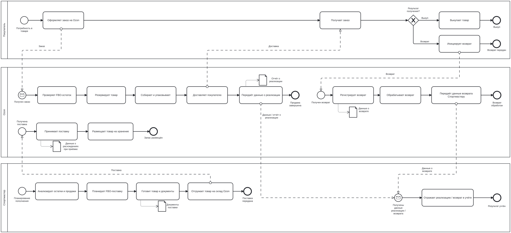
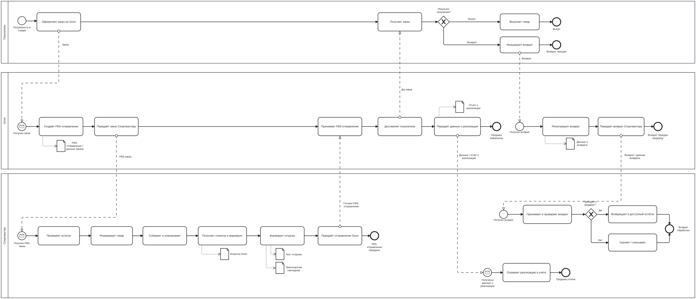
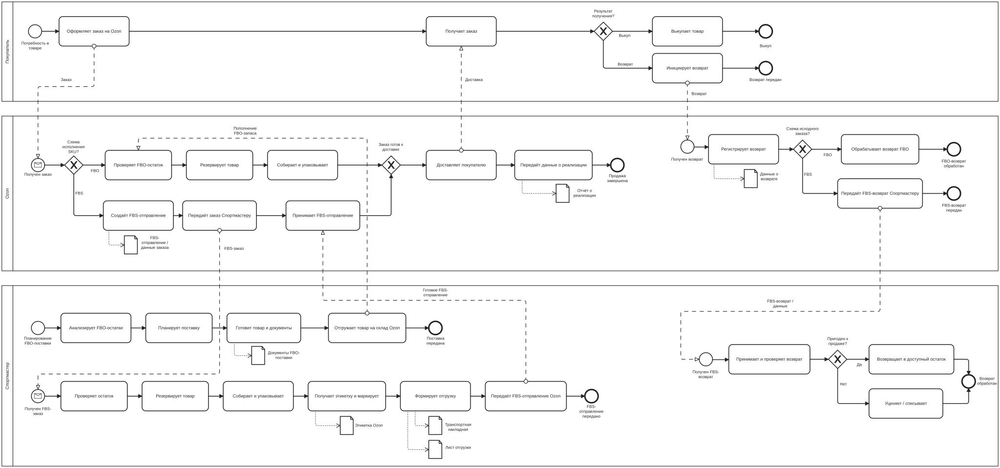
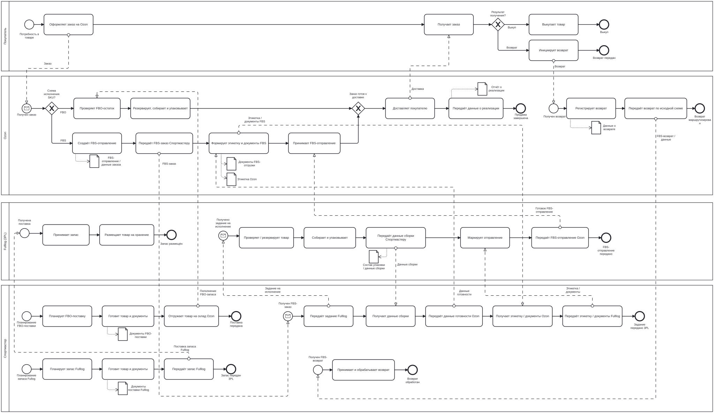

# Sportmaster × Ozon: от выбора FBO / FBS к управляемой модели исполнения

## Контекст

В исходной модели товар продаётся через FBO: запас заранее поставляется на склад Ozon, а маркетплейс исполняет заказ. Задача состояла в том, чтобы оценить запуск FBS и выбрать модель, которая улучшит операционный результат продаж на Ozon.

Я выполнил решение за 5 дней: построил сценарную финансовую модель, описал процессы, интеграционный контур и путь проверки решения на пилоте.

## 1. Как изменил постановку задачи

Выбор между FBO и FBS для всего каталога слишком грубый: одна и та же схема может быть выгодна для одних SKU и убыточна для других. Поэтому единицей решения стал отдельный SKU.

**Цель:** максимизировать операционную прибыль портфеля.

**Ограничения:** не допустить неконтролируемых отмен по SLA, ошибок обработки, ухудшения срока доставки и роста проблемных возвратов.

## 2. Сценарии

| Сценарий | Логика |
| --- | --- |
| FBO | Запас хранится у Ozon, маркетплейс собирает и доставляет заказ. |
| Собственный FBS | Запас хранится у Sportmaster; компания резервирует товар, собирает, упаковывает, маркирует и передаёт отправление Ozon. |
| Hybrid | Для каждого SKU выбирается FBO или FBS по итоговой экономике. |
| Hybrid + Fulllog | FBO-часть остаётся у Ozon, а FBS-операции выполняет внешний фулфилмент-партнёр. |

Две позиции с отрицательным результатом в обеих схемах исключаются из активных продаж до пересмотра их экономики.

## 3. Финансовая модель

В модели учтены цена, себестоимость, объём, возвраты, оборачиваемость, тарифы и операционные расходы. На уровне SKU определяется схема FBO, FBS или пауза; затем результаты агрегируются в единый P&L сценария.

| Сценарий | Операционная прибыль, ₽/мес. | Операционная маржа | Разница к FBO, ₽/мес. |
| --- | ---: | ---: | ---: |
| FBO | 2 151 648 | 14,8% | 0 |
| FBS | 2 608 490 | 20,3% | +456 842 |
| Hybrid | 2 938 795 | 21,5% | +787 147 |
| Hybrid + Fulllog | 3 064 647 | 22,4% | +912 999 |

Ключевая разница между сценариями создаётся не ростом спроса, а структурой затрат: хранением, первой милей, сборкой, упаковкой, передачей FBS-заказов, логистикой и обработкой возвратов.

**Рекомендация модели:** проверить на пилоте Hybrid + Fulllog. По расчёту он даёт на 125 852 ₽ в месяц больше собственного Hybrid, но перед масштабированием нужно подтвердить коммерческие условия, SLA и устойчивость операций.

Полный расчёт доступен в [финансовой модели](../assets/model/financial_model.xlsx).

## 4. Как работает решение

### FBO: текущая модель

Sportmaster планирует и поставляет запас на склад Ozon. Далее Ozon хранит товар, исполняет заказ, доставляет его покупателю и передаёт данные о реализации или возврате.

### Собственный FBS

После заказа на Ozon Sportmaster проверяет остаток, резервирует товар, собирает, упаковывает и маркирует отправление, затем передаёт его Ozon. При возврате товар проверяется и возвращается в доступный остаток либо уценивается или списывается.

### Hybrid

Схема исполнения выбирается для SKU: FBO-ветка использует запас Ozon, FBS-ветка — запас и операции Sportmaster. Это распределение SKU между моделями, а не одновременное исполнение одного заказа двумя способами.

### Hybrid + Fulllog

В FBS-ветке Fulllog принимает и хранит запас, собирает, упаковывает, маркирует и передаёт отправление Ozon. Sportmaster управляет ассортиментом, заданиями и контролем результатов.

## 5. Интеграционный контур

Для FBS требуется связать внешний контур Ozon с внутренним контуром продавца: обработать новый заказ, проверить состав и остаток, передать задание на сборку, получить маркировочные данные, подтвердить передачу отправления и синхронизировать статусы, продажи и возвраты.

В подробном описании зафиксированы роли систем и требования к сверке, повторной обработке и контролю расхождений — без предположений о конкретной внутренней инфраструктуре Sportmaster.

[Открыть интеграционный контур →](INTEGRATION_CONTOUR.md)

## 6. Метрики и запуск

Операционная прибыль — целевая метрика. Её недостаточно максимизировать изолированно, поэтому в пилоте контролируются SLA передачи FBS-заказов, отмены, ошибки обработки, сроки доставки и возвраты.

Путь запуска: **Discovery → Delivery → Pilot → Scale**. После пилота возможны три решения: масштабировать, исправить и повторить или остановить сценарий.

[Открыть метрики и пилот →](METRICS_AND_PILOT.md)

## 7. Что должно быть подтверждено до масштабирования

- коммерческие тарифы и SLA Fulllog;
- влияние FBS на срок доставки и спрос;
- фактическая экономика на ограниченном потоке;
- отсутствие критичных расхождений между заказами, остатками и статусами;
- способность процессов выполнять SLA передачи заказа Ozon.

[Открыть риски и действия →](RISKS.md)
